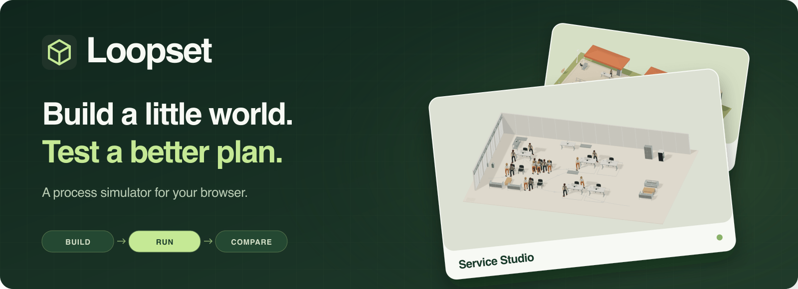
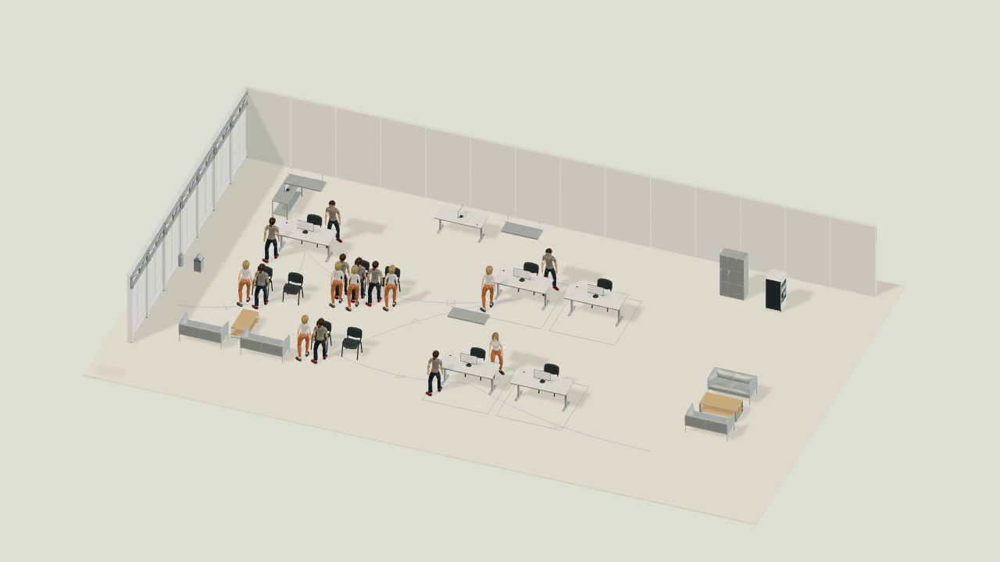
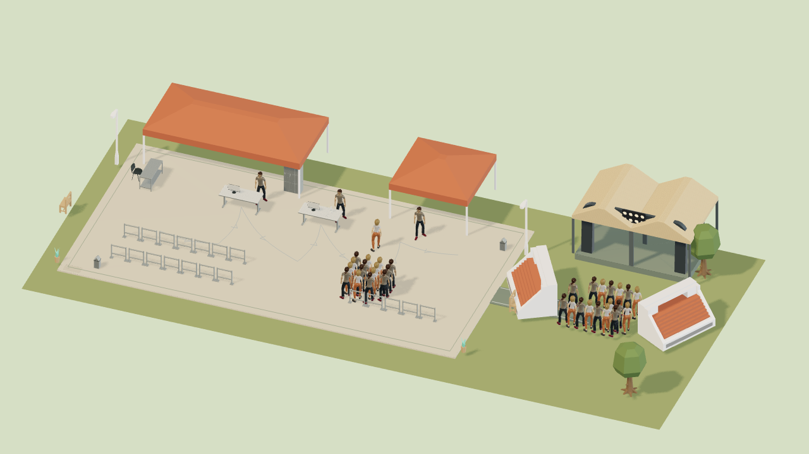
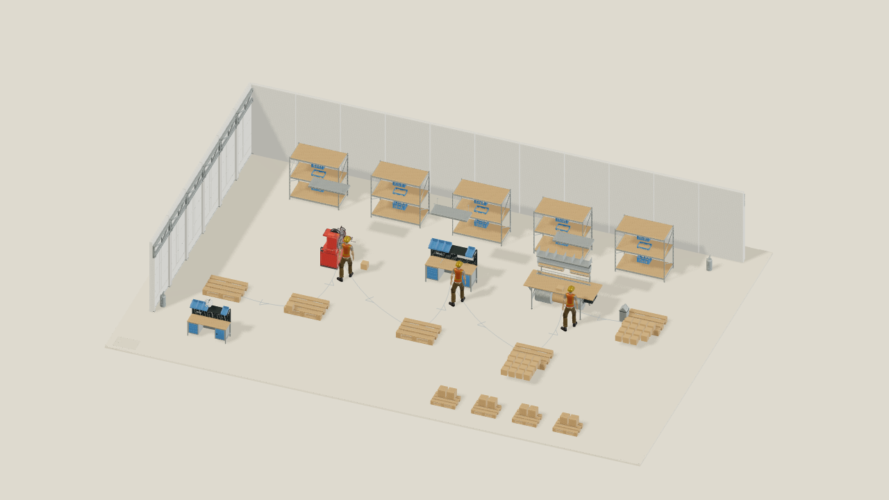

<p align="center">
  
</p>

<p align="center">
  <a href="https://berkebasbay.github.io/loopset/"></a>
  <a href="https://berkebasbay.github.io/loopset/"></a>
  <a href="LICENSE"></a>
</p>

<p align="center">
  <strong><a href="https://berkebasbay.github.io/loopset/">Try Loopset →</a></strong> ·
  <a href="docs/QUICKSTART.md">Quickstart</a> ·
  <a href="CONTRIBUTING.md">Contribute</a>
</p>

Loopset lets you build a small factory, service team or event, then see how a different plan affects queues, waiting and cost. It runs in your browser, with no installation or account.

## See it in action

https://github.com/user-attachments/assets/42cf61e9-e756-4939-8fbe-9a2239fef163

<sub>30-second tour · <a href="https://berkebasbay.github.io/loopset/watch/">Captions & downloads</a> · <a href="docs/media/README.md">Video credits</a></sub>

<details>
<summary><strong>Watch the full walkthrough · 55 seconds</strong></summary>

https://github.com/user-attachments/assets/03fb5577-61f1-4ac8-a22f-95c133f78d10

</details>

## Build. Run. Compare.

- **Build your world.** Choose one of 12 templates or start with an empty site. Drag in equipment, shelves and work areas from 1,141 ready-to-use 3D models.
- **Try a different plan.** Change arrivals, processing time or staffing. Run it and compare completed work, waiting and resource cost.
- **Make it yours.** Save your project, keep alternatives, or turn your setup into a reusable template.

### Pick a place to start

| Service Studio | Festival Gate | Little Factory |
| :---: | :---: | :---: |
|  |  |  |
| Teams & waiting | Arrivals & queues | Production & capacity |

[Explore all templates →](docs/TEMPLATES.md)

<details>
<summary><strong>Run locally & develop</strong></summary>

Use Node.js 24 and npm:

```sh
npm ci
npm run dev
```

Open the local address printed by Vite. No API keys or backend setup.

The engine also runs without the interface. See the [Engine API](docs/API.md), [model guide](docs/MODEL_GUIDE.md), and [contribution guide](CONTRIBUTING.md).

</details>

## Help build Loopset

New templates, clearer guides, accessible interactions and focused bug fixes are welcome. [Open an issue](https://github.com/berkebasbay/loopset/issues/new/choose) or [send a pull request](CONTRIBUTING.md).

---

<sub>The 3D scene illustrates your process model; walking and layout do not change the calculation. Examples use synthetic data. <a href="docs/MODEL_GUIDE.md">Modeling scope</a> · Original code: <a href="LICENSE">MIT</a>. Artwork, fonts and media retain their <a href="THIRD_PARTY_NOTICES.md">own licenses</a>.</sub>
