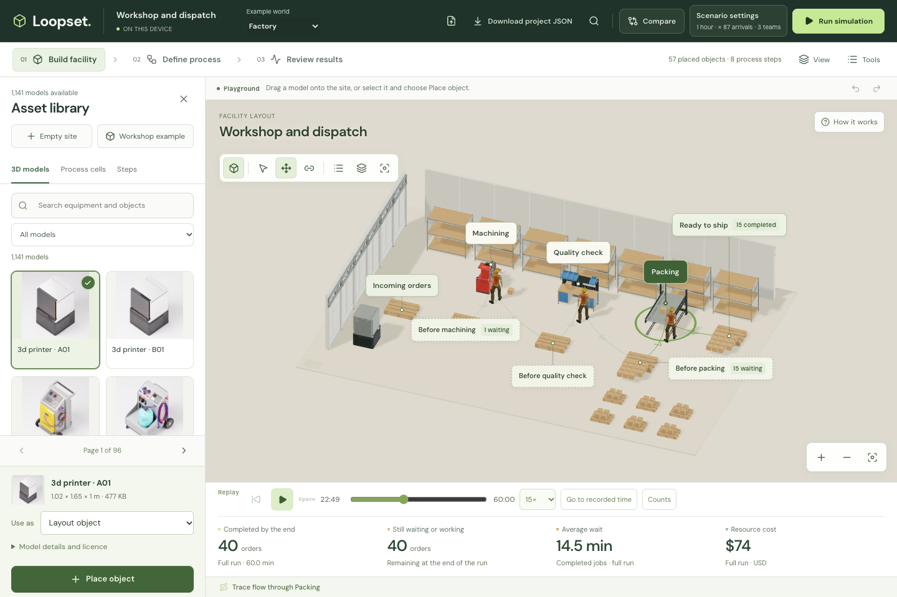
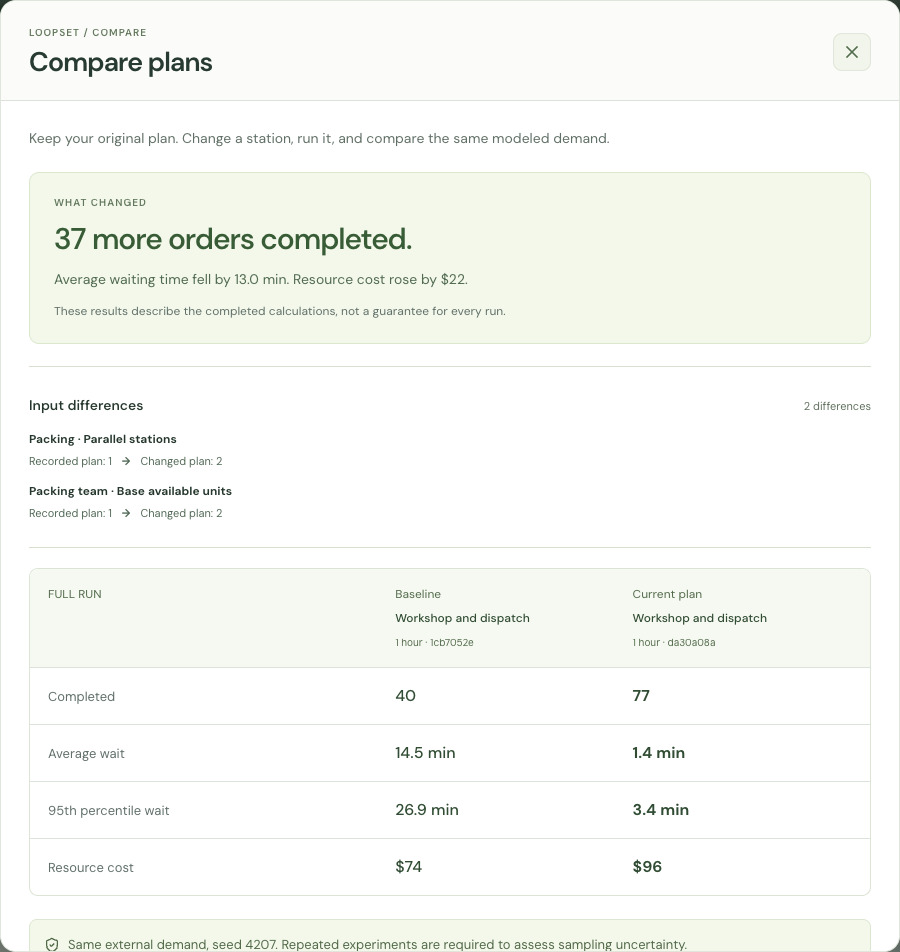

# Loopset

**Build a little world. Test a better plan.**

Loopset is a visual process and capacity simulator. Explore a factory, a festival entrance or a service studio; change demand, processing time and staffing, then compare what happens to queues, completed work and cost.

Free, client-side and account-free. Simulations run in your browser without a paid API or simulation backend. Your models stay on your device.

**[Try Loopset in your browser →](https://berkebasbay.github.io/loopset/)** · [Watch the demo](docs/media/loopset-demo.mp4)

Start with an editable workshop, place models from the library, then define the process and compare plans. Choose **Templates** for Workshop, Factory, Festival, Service or a completely blank site. Save your own starting points in **My templates**. No installation needed.

[](https://berkebasbay.github.io/loopset/)

[Watch the capacity-comparison demo (RC9)](docs/media/loopset-demo.mp4) · [Facility guide](docs/FACILITY_GUIDE.md)

[Quickstart](docs/QUICKSTART.md) · [Workspace guide](docs/UX_GUIDE.md) · [Model guide](docs/MODEL_GUIDE.md) · [Engine API](docs/API.md) · [Examples](examples/README.md)

## One more station. The same output.

An extra workstation can still wait for the same team. In the included synthetic Factory, the same 80 arrivals produce:

| Plan | Packing stations | Packing team units | Orders completed | Resource cost |
| --- | ---: | ---: | ---: | ---: |
| Original | 1 | 1 | 40 | $74 |
| Extra station | 2 | 1 | 40 | $74 |
| Extra station and team capacity | 2 | 2 | 77 | $96 |

One modeled hour, seed 4207. These are recorded outcomes from one synthetic case; resource cost is not total business cost. Repeated experiments are available to examine sampling uncertainty.

## Run locally

Requires **Node.js 24** and npm.

```sh
npm ci
npm run dev
```

Open the local address printed by Vite. There are no account credentials, API keys or application-server settings to configure.

## One engine, three worlds

| World | Question to explore |
| --- | --- |
| Little Factory | Where does work accumulate as machining, inspection and packing compete for capacity? |
| Festival Gate | How do arrival waves, checkpoints and visitor patience affect the entrance queue? |
| Service Studio | What happens when priority requests and multiple stages share the same specialists? |

Start with an example or create a small **New model**. Every example uses synthetic data and the same discrete-event engine.

## From a question to a comparison

1. Open **Scenario settings** beside Run to set the duration. Select an arrival source to adjust its rate or preview a different arrival profile.
2. Select a step in the world or searchable **Steps** list. **Properties** puts its processing, waiting and team controls together; on a phone, use **Edit selected step** below the world.
3. Change parallel stations, team availability or shifts deliberately: they are separate limits. Mean-time editing can preserve the existing distribution shape.
4. Calculate the plan. **Compare** shows both input differences and recorded outcomes; repeated experiments help examine sampling uncertainty.
5. Name and save alternatives, then **Download project JSON** to keep a portable editable copy.



## Model and experiment

- Build flows from arrival sources, queues, processing stations, routes, delays and exits. Copy steps, preview connections and apply compatible group edits with Undo/Redo.
- Model fixed or variable arrival rates, exact timestamps, time distributions, queue capacity, patience, priorities, shared resources and calendars.
- Run independent replications, matched-input comparisons or a finite capacity search with separate verification runs. Search changes a resource pool's base availability; station counts and shift overrides stay explicit.
- Inspect waiting distributions, work remaining, resource cost and observed bottleneck candidates. Export run JSON, CSV, PNG or HTML, or use the browser's print/PDF path.

[View the recorded-results screen](docs/media/loopset-insights.png). The complete DOM model editor remains available under **Tools**. Command search, a short optional guide and keyboard alternatives support the same workspace.

## Build your facility

The workspace separates **Build facility**, **Define process** and **Review results**. The docked **Asset library → 3D models** lets you search and drag equipment, shelves, building parts and containers onto the site. **Empty site** starts with no objects or process steps. Add **Start a process** when ready to simulate. Layout objects have position, elevation, rotation and scale controls; process cells add connected waiting and processing stages with explicit team settings. Models load when used, and repeated instances share geometry.

**Save as template** keeps a reusable snapshot in this browser. Each use creates an independent project. Templates can be downloaded or imported as project JSON.

Facilities and their saved scenarios travel in project JSON. Artwork and arrangement remain separate from numerical behavior; a machine model does not supply real processing measurements or physical transport rules. See the [facility guide](docs/FACILITY_GUIDE.md) for building, comparing and reopening a complete project.

Choose **Templates → Workshop** to open this layout, or use its [portable project JSON](examples/facility.json).

Use **How it works** in the world for the optional three-step guide. Common edits preserve distribution shapes, separate stations from teams, and keep calendar changes explicit.

## Use the engine without the interface

```sh
npm run build:engine
npm run simulate -- --example factory --seed 4207
npm run simulate -- examples/service.json
```

Results retain their model snapshot, seed, engine/RNG identity and calculation limits. See the [API](docs/API.md) for reproducible runs and experiments.

## Know the scope

The miniature world illustrates the process: layout, walking, camera and replay speed do not add physical travel time or change numerical outcomes. Detailed replay is bounded separately from full-run metrics; incomplete or cancelled calculations remain explicitly incomplete.

Loopset models process flows and capacity, rather than collisions, CAD geometry or inventory assembly. Synthetic examples are not validated forecasts of real businesses. A single run does not establish statistical confidence or guarantee that more capacity will improve a process.

Projects save in browser storage at the current site address. Download JSON backups to transfer work or protect it from cleared browser storage.

## Develop and contribute

```sh
npm run typecheck
npm test -- --maxWorkers=1
npm run build
npm run test:headless
```

`npm run preview` serves a production build locally. See [CONTRIBUTING](CONTRIBUTING.md) for architecture boundaries, focused checks and synthetic examples, or [SECURITY](SECURITY.md) for vulnerability reporting.

## License and credits

Original Loopset code is [MIT licensed](LICENSE). Dependencies, fonts and third-party artwork retain their own licenses; they are not all MIT. See [third-party notices](THIRD_PARTY_NOTICES.md), [asset sources and adaptations](docs/NVIDIA_ASSETS.md), and the asset manifests distributed with the project.
