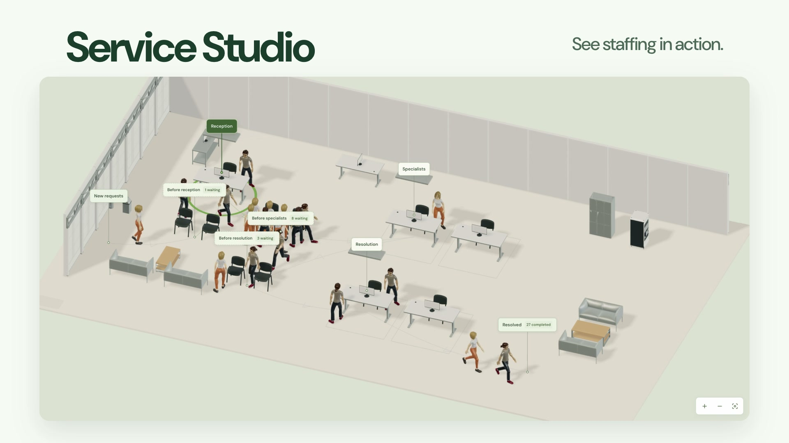

# Loopset

**Build a little world. Test a better plan.**

Loopset is a free, open-source process and capacity simulator that runs in your browser. Build a facility, change demand or staffing, and compare completed work, waiting time and resource cost before choosing a plan.

**[Try the live app →](https://berkebasbay.github.io/loopset/)** · **[Watch the 30-second tour](https://berkebasbay.github.io/loopset/watch/#short)** · **[Watch the 55-second walkthrough](https://berkebasbay.github.io/loopset/watch/#full)**

[](https://berkebasbay.github.io/loopset/watch/#full)

**12 editable templates · 24 prepared alternatives · 1,141 browser-ready 3D models**

No account, installation, API key or simulation backend. Calculations run locally, and project files stay on your device. Start from a template or a genuinely empty site, then save your own reusable starting points.

## Compare the trade-off

In the included synthetic **Service Studio**, the Specialists and Resolution steps share the same team. Increasing the shared team from two to three available units produces this comparison:

| Recorded outcome | Original plan · 2 units | Changed plan · 3 units |
| --- | ---: | ---: |
| Completed requests | 66 | 86 |
| Average waiting time | 9.5 min | 5.2 min |
| Modeled resource cost | $85 | $115 |

The videos show the real edit, **Run & compare**, and the resulting table. Both plans use the same 106 arrivals, one-hour duration and seed 4207. Station counts and the break calendar stay unchanged. These are rounded results from one synthetic case, not a forecast or a promise of savings; resource cost is not total business cost.

| Video | Watch online | Repository file |
| --- | --- | --- |
| Quick tour · 30 seconds | [Watch](https://berkebasbay.github.io/loopset/watch/#short) | [English MP4](public/media/loopset-demo-short.mp4) |
| Full walkthrough · 55 seconds | [Watch](https://berkebasbay.github.io/loopset/watch/#full) | [English MP4](public/media/loopset-demo.mp4) |

Both videos include English screen text, music and effects. The [watch page](https://berkebasbay.github.io/loopset/watch/) includes captions and a text walkthrough. See the [media notes](docs/media/README.md) for sources and recording scope.

## Your first experiment

1. Open **Templates → Service Studio** and review its **Project brief**.
2. In **Define process**, select **Specialists**. In **Properties**, change the shared team's **Base available units** from 2 to 3.
3. Choose **Run & compare**. Read completed work, waiting and cost together.
4. Save an alternative or use **Download project JSON** to keep an editable copy. **Save as template** makes a reusable starting point in this browser.

For your own layout, choose **Blank** or **Empty site**, place objects, and use **Start a process** when you are ready to simulate. [Follow the quickstart →](docs/QUICKSTART.md)

## Start with a question

| Template | Explore |
| --- | --- |
| **Service Studio** | How do priority requests and multiple stages compete for shared specialists? |
| **Festival Gate** | What happens to queues when arrivals come in waves and visitors have limited patience? |
| **Little Factory** | Where does work accumulate across machining, inspection and packing? |
| **Workshop and eight more starters** | Shared work cells, machining, rework, 3D printing, packing, fulfillment, returns, parcel handling and repairs. |

Each starter has an original plan and two prepared alternatives, with editable assumptions and real scene previews. Apply an alternative, calculate it, compare it, or undo it. All examples use synthetic data and the same discrete-event engine. [Browse the template guide →](docs/TEMPLATES.md)

## Build, model and compare

- **Build the facility.** Search the 3D library and drag equipment, shelves, containers and building parts into place. Models load when used; repeated placements share geometry. Layout, elevation, rotation and scale are editable.
- **Define the process.** Connect arrivals, queues, processing steps, routes, delays and exits. Model time distributions, arrival waves, priorities, patience and finite waiting space. Copy steps and edit compatible groups with Undo/Redo.
- **Keep capacity explicit.** Parallel stations, shared resources, installed limits and shifts are separate controls. An extra workstation does not automatically add a worker.
- **Test alternatives.** Run independent replications, matched-input comparisons or a finite capacity search with separate verification runs. Inspect waiting distributions, unfinished work, cost and observed bottleneck candidates.
- **Keep and share your work.** Save projects and personal templates locally. Transfer editable project JSON; export results as JSON, CSV, PNG or HTML, or use print/PDF. Imported data is reviewed before it changes a model.

The workspace separates **Build facility**, **Define process** and **Review results**. A searchable Steps list, complete DOM model editor, keyboard controls and reduced-motion options provide alternatives to manipulating the 3D scene. [Read the workspace guide →](docs/UX_GUIDE.md)

## Run locally

Use **Node.js 24** and npm:

```sh
npm ci
npm run dev
```

Open the local address printed by Vite. No credentials or application-server setup are required. `npm run build` produces the static app; `npm run preview` serves that build locally.

The engine also works without the interface:

```sh
npm run build:engine
npm run simulate -- --example service --seed 4207
npm run simulate -- examples/factory.json
```

Results retain their input snapshot, seed, engine/RNG identity and calculation limits. [Use the headless API →](docs/API.md)

## What the simulation represents

The miniature world illustrates a process. Walking, scenery, camera position and replay speed do not change numerical outcomes or add physical travel time. A 3D machine model does not supply measured processing times, collision physics, CAD analysis or inventory-assembly behavior.

Synthetic examples are not calibrated business forecasts. A single run does not establish statistical confidence; repeated experiments help examine uncertainty. Incomplete calculations and limited replay remain explicitly identified.

Browser storage belongs to the current site address and browser. Download project JSON backups to transfer work or protect it from cleared storage.

## Documentation

[Quickstart](docs/QUICKSTART.md) · [Templates](docs/TEMPLATES.md) · [Facility guide](docs/FACILITY_GUIDE.md) · [Workspace guide](docs/UX_GUIDE.md) · [Model contract](docs/MODEL_GUIDE.md) · [Engine API](docs/API.md) · [Examples](examples/README.md) · [Testing](docs/QUALITY.md) · [Static hosting](docs/DEPLOYMENT.md)

## Contribute

Useful contributions include a template with a clear process question, a focused bug fix, an accessible editing improvement, a clearer guide or an independently reasoned engine test.

[Open an issue](https://github.com/berkebasbay/loopset/issues/new/choose) with a small synthetic example, or propose a focused pull request. For larger changes, discuss the problem and scope first. [CONTRIBUTING.md](CONTRIBUTING.md) covers setup, model boundaries and the required checks. Pull requests are welcome and reviewed for correctness, usability and maintainability.

```sh
npm run typecheck
npm test -- --maxWorkers=1
npm run build
npm run test:headless
```

Report vulnerabilities through [SECURITY.md](SECURITY.md).

## License and credits

Original Loopset code is [MIT licensed](LICENSE). Third-party models, textures, fonts, music and effects retain their own terms; they are not all MIT. See [third-party notices](THIRD_PARTY_NOTICES.md), [NVIDIA asset sources and adaptations](docs/NVIDIA_ASSETS.md), and [demo media credits](docs/media/README.md).
