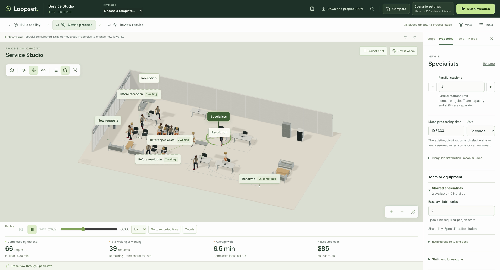
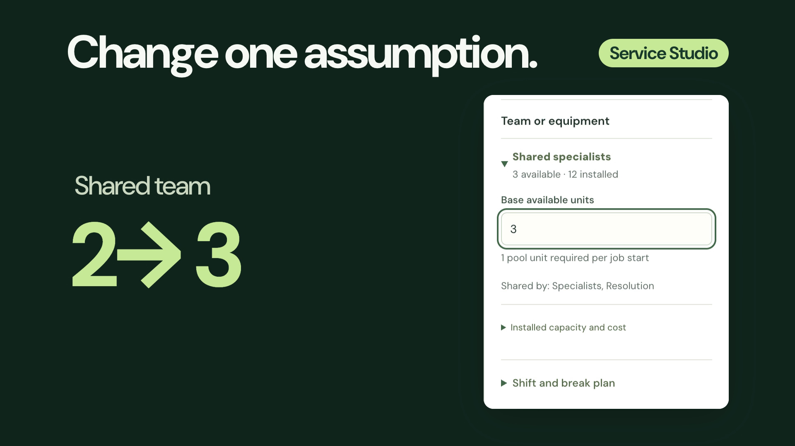
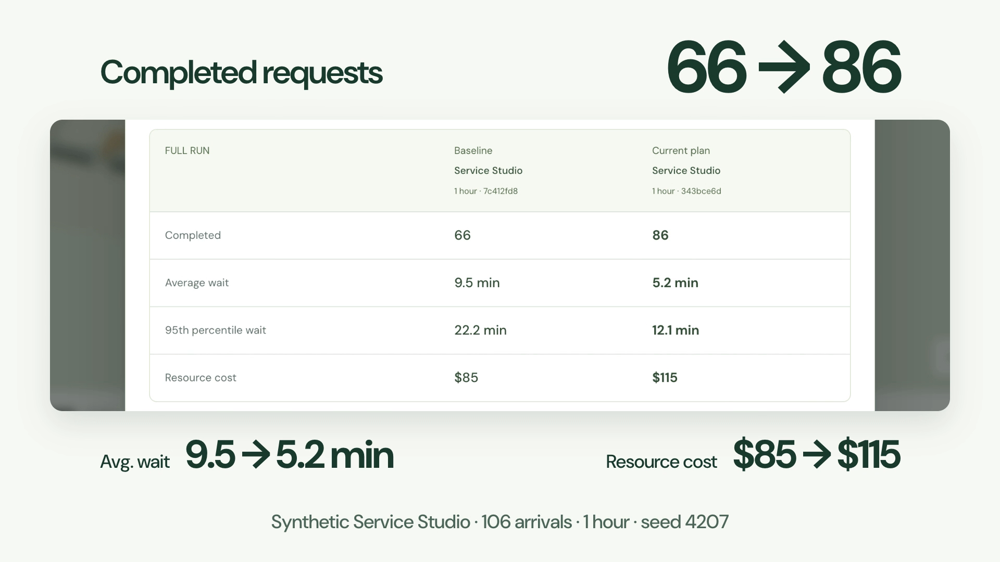

<p align="center">
  
</p>

<p align="center">
  <a href="https://berkebasbay.github.io/loopset/"></a>
  <a href="https://berkebasbay.github.io/loopset/"></a>
  <a href="LICENSE"></a>
</p>

<p align="center">
  <strong><a href="https://berkebasbay.github.io/loopset/">Try Loopset →</a></strong> ·
  <a href="docs/README.md">Documentation</a> ·
  <a href="CONTRIBUTING.md">Contribute</a>
</p>

**A simulation playground for process ideas.** Build a factory, a service team or an event. Change how work arrives, how long it takes or who is available, then see what happens to queues, waiting and cost.

Loopset is free and runs in your browser. Your projects stay on your device, with no account or installation required.

## See it in action

From a working template to a real comparison: explore the world, change the shared team and run the next plan.

https://github.com/user-attachments/assets/42cf61e9-e756-4939-8fbe-9a2239fef163

<sub>30-second tour · <a href="https://berkebasbay.github.io/loopset/watch/">Captions & downloads</a> · <a href="docs/media/README.md">Media credits</a></sub>

<details>
<summary><strong>Watch the full walkthrough · 55 seconds</strong></summary>

https://github.com/user-attachments/assets/03fb5577-61f1-4ac8-a22f-95c133f78d10

</details>

## A tour of the workspace

### 01 · Start with a world you can change

Choose from **12 editable templates**, each with a starting plan and two prepared alternatives, or start with an empty site. Arrange your facility with **1,141 ready-to-use 3D models**, then define the process that makes it work.

<p align="center">
  
</p>

<sub>Service Studio: reception, specialists and resolution in one editable workspace. <a href="docs/FACILITY_GUIDE.md">Build your own facility →</a></sub>

### 02 · Turn a question into an experiment

Select a step and adjust processing time, parallel stations or the team it needs. Stations, people and shifts are separate decisions. In this example, the shared specialist team changes from **2 available units to 3**, while the station count and break plan stay the same.

<p align="center">
  
</p>

<sub>The real editor, enlarged in the walkthrough. <a href="docs/QUICKSTART.md#reproduce-the-service-studio-demo">Try this experiment →</a></sub>

### 03 · See the result and the trade-off

Run the changed plan and compare it with the original. Here, completed requests rise from **66 to 86** and average waiting falls from **9.5 to 5.2 minutes**. The extra capacity also raises modeled resource cost from **$85 to $115**.

<p align="center">
  
</p>

<sub>One synthetic example: 106 arrivals, one hour, seed 4207. Results depend on the model's assumptions; resource cost is not total business cost. <a href="docs/MODEL_GUIDE.md#measurement-and-interpretation">How to read a result →</a></sub>

Save the plan, keep it as a reusable template, or download an editable project file. Repeated experiments and matched-input comparisons are available when you want to investigate uncertainty beyond a single run.

## Find your starting point

| Service Studio | Festival Gate | Little Factory |
| :---: | :---: | :---: |
|  |  |  |
| Teams & waiting | Arrivals & queues | Production & capacity |

The collection also includes workshops, machining, rework, 3D printing, packing, fulfillment, returns, parcel handling and repairs. [Explore the templates and their experiments →](docs/TEMPLATES.md)

## Documentation

**[Browse all guides →](docs/README.md)**

| I want to… | Start here |
| --- | --- |
| Run my first experiment | [Quickstart](docs/QUICKSTART.md) · [Starter templates](docs/TEMPLATES.md) |
| Build a facility and edit its process | [Facility guide](docs/FACILITY_GUIDE.md) · [Workspace guide](docs/UX_GUIDE.md) |
| Understand assumptions and results | [Model guide](docs/MODEL_GUIDE.md) · [Export and sharing](docs/SHARING.md) |
| Use the engine in my own project | [Headless API](docs/API.md) · [Architecture](docs/ARCHITECTURE.md) |
| Develop, test or host Loopset | [Contributing](CONTRIBUTING.md) · [Testing](docs/QUALITY.md) · [Static hosting](docs/DEPLOYMENT.md) |
| Find artwork sources and licenses | [Asset catalogue](docs/CATALOGUE.md) · [Asset attribution](docs/NVIDIA_ASSETS.md) · [Media credits](docs/media/README.md) |

<details>
<summary><strong>Run locally</strong></summary>

Use Node.js 24 and npm:

```sh
npm ci
npm run dev
```

Open the local address printed by Vite. No API keys or backend setup are required. The [contribution guide](CONTRIBUTING.md) covers checks and development conventions.

</details>

## Help build Loopset

New templates, clearer guides, accessible interactions and focused bug fixes are welcome. [Open an issue](https://github.com/berkebasbay/loopset/issues/new/choose) or [send a pull request](CONTRIBUTING.md). For a larger change, discuss the problem and scope first.

---

<sub>The 3D scene illustrates your process model; walking and layout do not change the calculation. Examples use synthetic data. <a href="docs/MODEL_GUIDE.md">Modeling scope</a> · Original code: <a href="LICENSE">MIT</a>. Artwork, fonts and media retain their <a href="THIRD_PARTY_NOTICES.md">own licenses</a>.</sub>
